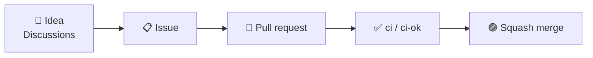

# Contributing

## Lanes

| Lane | Paths | Who merges |
| --- | --- | --- |
| 🏆 Showcase | `examples/**` | Anyone may open one. Merges after `ci / ci-ok` and a review |
| 📚 Guide | `skills/craft/guides/**` | Maintainer review. Start from `skills/craft/guides/_template.md` |
| 🧠 Skill or rules | `skills/**`, `agents/**`, plugin manifests, `tools/**`, `.github/**` | Maintainer only. They run inside people's AIs |

Keep to one open pull request per person. Fill in the pull request template. `tools/merge_policy.py` decides by path.

| Change | How |
| --- | --- |
| An idea | Start in [Discussions](https://github.com/SoulCraft-Org/anything-crafter/discussions/categories/ideas). An accepted idea becomes an issue |
| The plan | Edit [`docs/PLAN.md`](docs/PLAN.md) or the README in a pull request. Name the source and date of every figure |
| Every commit | Sign off with `git commit -s` ([DCO](https://developercertificate.org/)) |
| Every pull request | `ci / ci-ok` must pass: the voice lint over every Markdown file |
