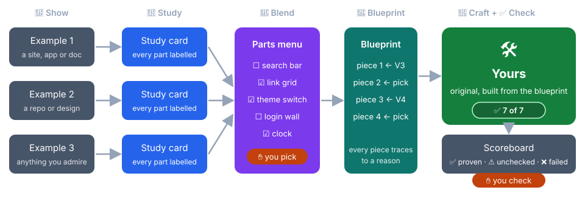
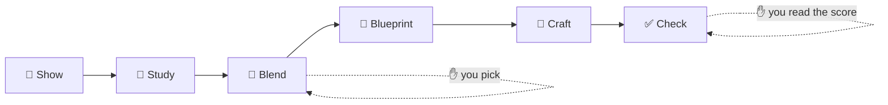
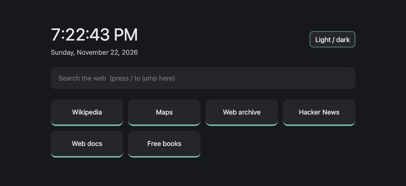

# 🛠️ Anything Crafter

> **Show it. Study it. Craft yours.**

Show your AI examples. It learns how they are built, then builds yours. Any AI, any model.

## 🚀 Try it now

Send this to your AI. It uses the `craft` skill if installed.

```text
Use the craft skill from Anything Crafter. I want to build: <what you want>.
Examples to study: <link, file or name>, <link, file or name>.
Ask me your questions once, study every example, let me pick the parts, then build mine.
No skill? Follow PASTE.md from github.com/SoulCraft-Org/anything-crafter instead.
```





## 🤖 Works with

| Your AI | Run this |
| --- | --- |
| Claude Code | `claude plugin install anything-crafter --marketplace SoulCraft-Org/anything-crafter` |
| 50+ agents: OpenCode, Codex, Cursor, Goose, Hermes, OpenClaw, deepseek-harness, Qwen Code, Copilot | `npx skills add SoulCraft-Org/anything-crafter` |
| Chat apps (claude.ai, Gemini app) | Upload `craft.zip` from Releases |
| ChatGPT, anything else | Paste [`PASTE.md`](PASTE.md) |
| Always-on, any AI | Paste [`rules.md`](skills/craft/references/rules.md) into `AGENTS.md` or `CLAUDE.md` |

## 📜 The 5 rules

| # | Rule | In one line |
| --- | --- | --- |
| 1 | ✨ Vision first | Ask what is yours before looking at examples |
| 2 | 🔬 Study before you build | No design until every example is studied |
| 3 | 🔎 Evidence, not guesses | Every claim is Seen, Inferred or Unknown |
| 4 | 🧬 Learn the how, never copy the what | Patterns yes. Code, text, art, names and locks no |
| 5 | ✅ Done means proven | Nothing is done until the check ran |

## 📚 Guides

| Your example is | Guide | Studied with |
| --- | --- | --- |
| 🌐 A website | [website](skills/craft/guides/website.md) | Browser tool, else page fetch |
| 🖥️ A web app | [web app](skills/craft/guides/web-app.md) | Browser tool, else page fetch |
| 📦 Code: repo, CLI, package, plugin, skill | [code](skills/craft/guides/code.md) | `gh` and file reads |
| 📄 A doc or deck | [doc and deck](skills/craft/guides/doc-deck.md) | File reads |
| 🎨 A design | [design](skills/craft/guides/design.md) | File reads, Figma tool or vision |
| 📱 An app or binary | [app and binary](skills/craft/guides/app-binary.md) | `rea`, added on your yes. Static look by default |

## 🏆 Showcase

| # | Craft | Examples studied | Result | Score | Time |
| --- | --- | --- | --- | --- | --- |
| 1 | [One-file start page](examples/first-craft/) | 2 | 103 lines, one file | ✅ 7 of 7 | ~7 minutes |



Every craft keeps its files. Open it, read the scoreboard, check the claim.

## 🧪 Model report card

| Model | Harness | Show | Study | Blend | Blueprint | Notes |
| --- | --- | --- | --- | --- | --- | --- |
| Claude Sonnet 5.5 | Claude Code | ✅ | ✅ | ✅ | ✅ | showcase #1 |
| Nemotron 3.5 Super (open-weight) | OpenCode | ✅ | ✅ | ✅ | ✅ | 86 s |
| Nemotron 3.5 Lightning (open-weight) | OpenCode | ✅ | ✅ | ✅ | ⚠️ | 46 s, after one fix |

Tested, not claimed. Method and misses: [report card](examples/model-report-card.md).

## 📏 Small on purpose

| Budget | Limit |
| --- | --- |
| Skill | 1 skill, 100 lines at most |
| Rules | 90 lines at most |
| This README | 150 lines at most |
| Repo | Under 1 MB |
| Hooks | 0 |
| Questions | 1 round, 5 at most |

A test enforces every row on every pull request.

## 🙏 What we learned from each

Ideas only. No text copied. Star counts per day, read 2026-11-22.

| Repo | ⭐/day | What we took |
| --- | --- | --- |
| [deepseek-ai/deepseek-harness](https://github.com/deepseek-ai/deepseek-harness) | 2,830 | A short description is the trigger. The body loads on demand |
| [morluto/rea](https://github.com/morluto/rea) | 2,136 | A paste-able prompt first. Seen, Inferred, Unknown. Route by type |
| [DietrichGebert/ponytail](https://github.com/DietrichGebert/ponytail) | 1,208 | Every reply ends with what was skipped. Test small models |
| [mattpocock/skills](https://github.com/mattpocock/skills) | 1,132 | One round of questions, each pre-answered. Checkable done-criteria |
| [affaan-m/ECC](https://github.com/affaan-m/ECC) | 1,003 | Facts before the first edit. A reviewer needs proof |
| [obra/superpowers](https://github.com/obra/superpowers) | 793 | Evidence before claims. Excuse tables. A fresh reviewer |
| [multica-ai/andrej-karpathy-skills](https://github.com/multica-ai/andrej-karpathy-skills) | 786 | Few, memorable rules. Every change traces to the ask |

## 🤝 Contribute

| Lane | Who |
| --- | --- |
| Showcases | Everyone |
| Guides and the skill | A maintainer. They run inside people's AIs |

Start in [CONTRIBUTING](CONTRIBUTING.md).

## 📄 License

Apache-2.0. See [LICENSE](LICENSE) and [NOTICE](NOTICE).
