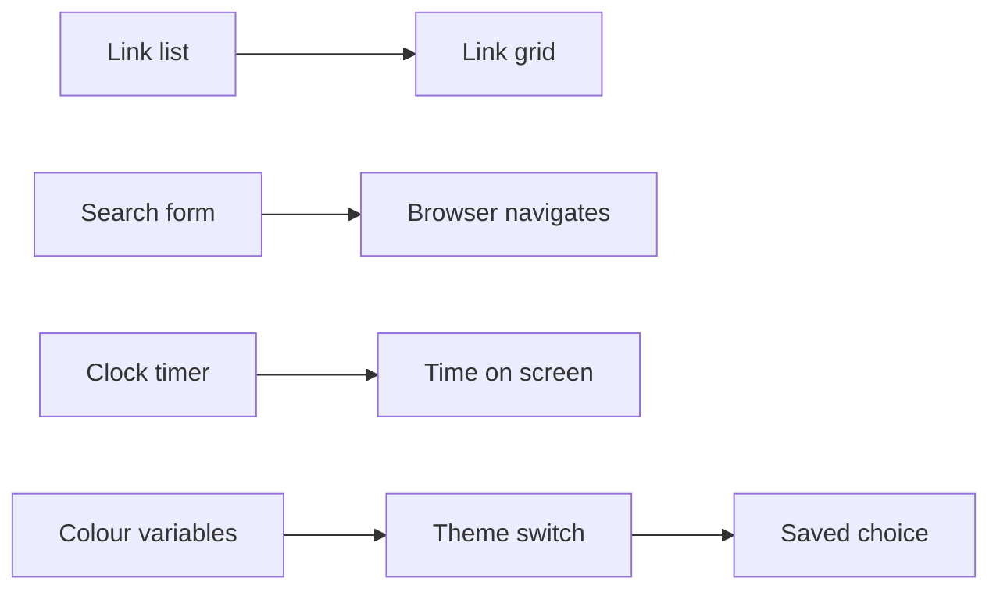

# Showcase 1: a one-file start page
A real run of the `craft` skill. Every file it wrote is in [`craft/`](craft/).

## The prompt
> Build me a one-file personal start page (search, favourite links, clock, light and dark, no build, no tracking). Learn from [flame](https://github.com/pawelmalak/flame) and [dashy](https://github.com/lissy93/dashy).

## Vision ([brief](craft/brief.md))
V1 one-file page: search, link grid, clock, light and dark. V2 anyone who wants a calm, private home page. V3 day one: search, open a link, read the time, switch theme. V4 mine: one file, no build, no tracking. V5 never copy an example, never call out on its own.

## Parts menu ([blend](craft/blend.md))
20 parts from 2 studies ([flame](craft/studies/flame.md), [dashy](craft/studies/dashy.md)). 12 picked. 8 left out: they break V4 or V5, or are Unknown.

## Blueprint ([blueprint](craft/blueprint.md))

## Result
Build and scoreboard come in the next pull request: `build/index.html` and `craft/check.md`.

## Numbers
| What | Count |
| --- | --- |
| Examples studied | 2 (flame, MIT, 6683 stars; dashy, MIT, 27055 stars) |
| Craft files so far | 5 |
| Result, scoreboard, time taken | next pull request |

## What this does not prove
One run, one maker, one small thing. It does not show the skill works for apps, designs or other models.
