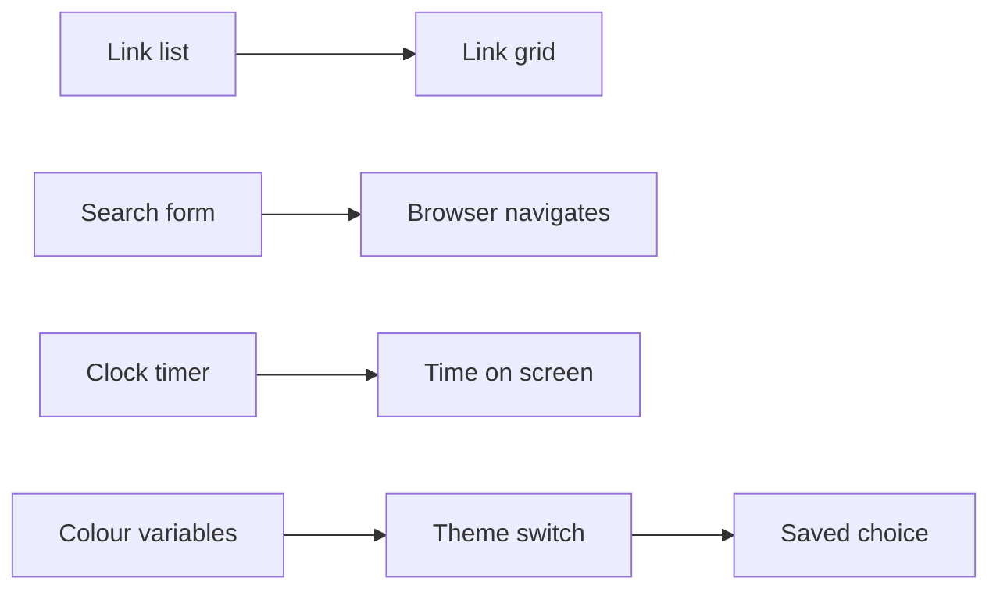

# Showcase 1: a one-file start page
A real run of the `craft` skill. Every file it wrote is in [`craft/`](craft/).

## The prompt
> Build me a one-file personal start page (search, favourite links, clock, light and dark, no build, no tracking). Learn from [flame](https://github.com/pawelmalak/flame) and [dashy](https://github.com/lissy93/dashy).

## Vision ([brief](craft/brief.md))
V1 one-file page: search, link grid, clock, light and dark. V2 anyone who wants a calm, private home page. V3 day one: search, open a link, read the time, switch theme. V4 mine: one file, no build, no tracking. V5 never copy an example, never call out on its own.

## Parts menu ([blend](craft/blend.md))
20 parts from 2 studies ([flame](craft/studies/flame.md), [dashy](craft/studies/dashy.md)). 12 picked. 8 left out: they break V4 or V5, or are Unknown.

## Blueprint ([blueprint](craft/blueprint.md))

## Result
[`build/index.html`](build/index.html): one file, 103 lines, no outside load. Open it in a browser.

## Scoreboard ([check](craft/check.md))
✅ 7 · ⚠️ 0 · ❌ 0 of 7 promises. Search and system light and dark were checked in a real browser.

## Numbers
| What | Count |
| --- | --- |
| Examples studied | 2 (flame, MIT, 6683 stars; dashy, MIT, 27055 stars) |
| Files | 6 craft files, 1 result file |
| Lines | 103 in the result, 208 in the craft files |
| Time taken | about 7 minutes, all 6 stages, one session |

## What this does not prove
One run, one maker, one small thing. The check was made by the builder, not a fresh reviewer, and no browser opened the page. It does not show the skill works for apps, designs or other models.
