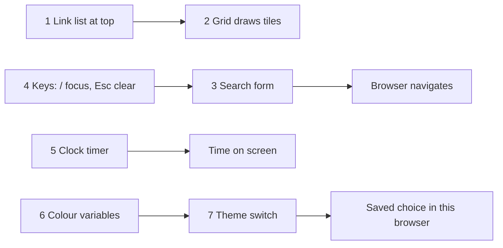

# Blueprint
Built from: brief.md, blend.md

## Diagram

No mermaid? Use ASCII: [list] -> [grid]   [form] -> [navigate]   [timer] -> [clock]   [variables] -> [switch] -> [saved choice]

## Pieces
| # | Piece | Traces to (V-line or pick) | Ladder step | What it is |
| --- | --- | --- | --- | --- |
| 1 | Link list | V3, pick 2 | 3 standard | One array at the top of the script: name and address pairs, edited by hand |
| 2 | Link grid | V3, pick 1 | 3 standard | A CSS grid that fills itself from the list, one anchor per tile |
| 3 | Search form | V3, pick 3 | 3 standard | A plain `<form>` with a `GET` action to one engine address, so no script is needed to search |
| 4 | Keyboard keys | V3, pick 4 | 3 standard | Press `/` to focus the box, `Esc` to clear it |
| 5 | Clock | V3, pick 7, pick 8 | 3 standard | A one-second timer writes the time using the browser's own locale format |
| 6 | Colour variables | V3, pick 9 | 3 standard | Four CSS variables on the root: background, text, tile, accent |
| 7 | Light and dark switch | V3, pick 10 | 4 new | `prefers-color-scheme` sets the start; a button sets `data-theme` and saves it in `localStorage` |
| 8 | One-file shell | V4, V5, pick 11, pick 12 | 3 standard | Inline style and script, no outside loads, and a no-referrer meta tag |

Why piece 7 is "write new": neither example follows the system setting, so steps 1 to 3 had nothing to reuse.

## Originality
What is mine: the whole page is one file with no build step and no tracking: open it and it works, even offline.
What I learned: group links as a list of tiles and join an engine address to the encoded query.
Also: redraw the clock by timer, paint the page with root variables and swap palettes by a name on the root.
Also: keep outside calls off unless the user asks.
