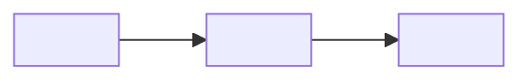

# Blueprint

Write it to `craft/blueprint.md`. Read only `craft/brief.md` and `craft/blend.md`. Do not reopen the examples.

## Fill in this blueprint

````
# Blueprint
Built from: brief.md, blend.md

## Diagram

No mermaid? Use ASCII: [A] -> [B] -> [C]

## Pieces
| # | Piece | Traces to (V-line or pick) | Ladder step | What it is |
| --- | --- | --- | --- | --- |
| 1 | <piece> | V3 | 3 standard | <one line> |
| 2 | <piece> | pick 4 | 4 new | <one line> |

## Originality
What is mine: <one line, from V4>
What I learned: <the how, with no names, text, art or code from an example>
````

## Reuse ladder

Take the first step that works. Write its number in the table.

| Step | Name | Ask |
| --- | --- | --- |
| 1 | Skip it | Does a V-line really need this? If no, drop the piece |
| 2 | Reuse what exists | Is it already in the person's project or files? |
| 3 | Standard | Does the standard library or the platform do it? |
| 4 | Write new | Say why steps 1 to 3 failed |

## Rules

1. Every piece names a V-line or a pick number. No name, no piece.
2. A piece with no trace is deleted, not explained.
3. Learn the how. Never copy the what: no example's text, art, code, name or brand.
4. The originality line is never empty. Empty means the design is a copy: redo it.
5. Fewer pieces beat more.
